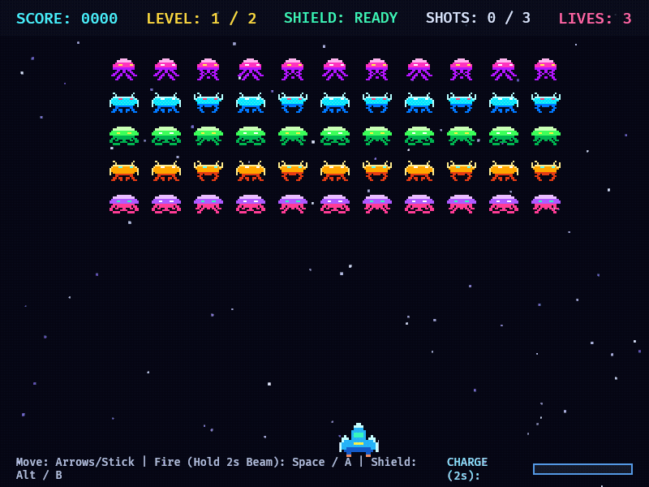

# Alien Attack



A fast-paced **Space Invaders** arcade clone built in **Rust** with the **Bevy Engine**.

**[Play in your Browser (WebAssembly on GitHub Pages)](https://baol.github.io/alien-attack/)**

## Features
- **Colorful Animated Aliens**: Multi-frame animated alien waves across **2 levels** (classic grid & twin-wing chevron formation) with swooping last-row attackers.
- **2s Charged Mega-Beam**: Tap to fire standard lasers (max 3 shots on screen), or hold fire for **2 seconds** to unleash a piercing plasma beam that destroys an entire column of ships.
- **Temporary Energy Shield & Respawn**: Activate a protective shield to absorb fire and vaporize diving aliens, or explode on impact and respawn with brief spawn protection.

## Controls

| Action | Keyboard | Controller (Xbox) |
| :--- | :--- | :--- |
| **Move** | `Left` / `Right` Arrows | Left Stick / D-Pad |
| **Fire / Charge (2s)** | `Space` (Tap / Hold) | **A** Button |
| **Temporary Shield** | `Alt` | **B** Button |
| **Toggle Fullscreen** | `F` / `F11` / `Alt+Enter` | **Y** / **View (Select)** |
| **Restart** | `R` / `Enter` | **Start** / **A** |

## Run

```bash
cargo run
```
